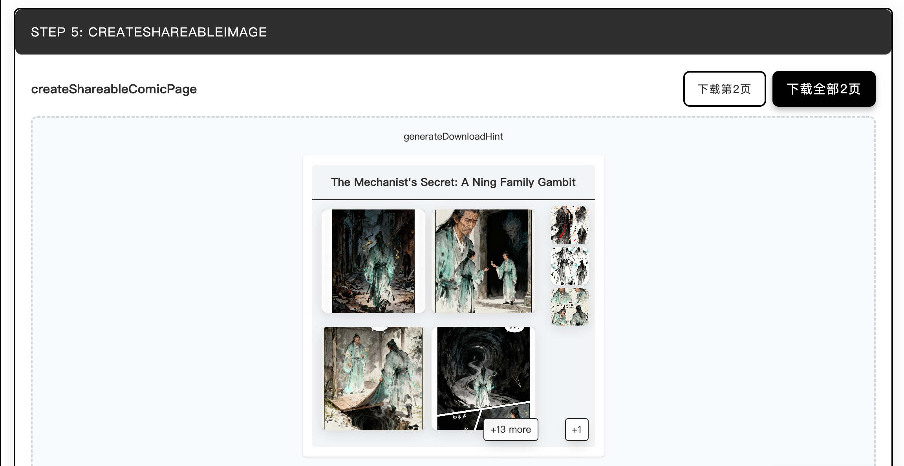

# Story to Manga · 故事创作工作台

把文字故事变成可以逐格打磨的漫画。先写故事、审核角色与分镜，再生成画面，最后精修和导出。

A bilingual story-to-manga workspace: write, review the storyboard, generate, then refine and export.

基于 [victorhuangwq/story-to-manga](https://github.com/victorhuangwq/story-to-manga) 扩展，使用 Next.js、React 和 TypeScript，保留 Google Gemini、火山引擎图像接口；本地创作无需注册或登录。

## 新版工作台（2026-10）

`/app` 已升级为四步创作流程，支持中文和英文：

| 步骤 | 操作 |
| --- | --- |
| 1. 写下故事 | 输入故事、选择画风和期望分镜数量，让 AI 拆解故事。 |
| 2. 确认角色与分镜 | 编辑角色、场景、镜头与对白，上传参考图，确认后再生成画面。 |
| 3. 生成漫画 | 按顺序生成并保存分镜，查看进度，暂停或继续缺失、待重绘的画面。 |
| 4. 精修与导出 | 单格重绘、修改图片、恢复历史版本，导出漫画页面、原图和项目备份。 |

故事拆解只调用文本接口；图片生成在确认分镜后单独开始。修改故事后，需要重新拆解并审核分镜。

### 主要功能

- **项目管理**：创建、切换和自动保存多个项目，兼容已有本地项目。
- **十种画风**：日系治愈、黑白漫画、东方水墨、复古美漫、韩式条漫、电影叙事、少女漫画、青年漫画、Q 版萌系、奇幻冒险。
- **角色与场景参考**：生成角色参考图，或上传自己的角色、场景图片。
- **可恢复的生成流程**：防止重复启动同一生成流程；每格保存后再开始下一格，继续时跳过已完成画面。
- **单格精修**：调整分镜描述、重绘或修改图片；每格保留最多三个先前图片版本。
- **导出**：单张图片、分页 PNG、原图与项目 ZIP、项目 JSON 备份。漫画页面每页最多六格，多页导出为 ZIP。
- **本地使用**：无需本站账户；保存、导出与分享文件均无需登录。右上角「关联 NeoWoW」提供注册推荐、CLI 安装、专用 Key 设置与本机关联检查。

## 快速开始

### 1. 准备环境并安装

使用 **Node.js 24** 和 **pnpm**；当前测试依赖 Node 的 TypeScript 转换能力。先确认 `node --version` 和 `pnpm --version` 可用。

```sh
git clone https://github.com/feifeixp/story-to-manga.git
cd story-to-manga
pnpm install --frozen-lockfile
```

请使用 `pnpm-lock.yaml` 安装。仓库现有 `package-lock.json` 与依赖声明不一致，`npm ci` 会失败。

### 2. 配置模型

需要实际故事拆解和生成时，复制配置模板：

```sh
cp .env.local.example .env.local
```

将 `.env.local` 中的占位值替换为自己的凭据：

```env
# 故事分析、分镜规划与 Google 图片生成
GOOGLE_AI_API_KEY=your_google_ai_api_key_here

# 当前代码的默认模型，可按账号可用模型调整
GOOGLE_TEXT_MODEL=gemini-2.5-flash
GOOGLE_IMAGE_MODEL=gemini-2.5-flash-image

# 可选：火山引擎图片生成；故事拆解仍需 Google 凭据
VOLCENGINE_API_KEY=your_volcengine_api_key_here

# 可选：Google Analytics；留空可禁用
NEXT_PUBLIC_GA_MEASUREMENT_ID=
```

Google 密钥入口：[Google AI Studio](https://aistudio.google.com/apikey)。火山引擎凭据入口：[火山引擎控制台](https://console.volcengine.com/)。实际可用模型与调用额度取决于供应商和账号权限。

密钥仅配置在本地环境文件或部署平台的服务端环境变量中。不要提交到 GitHub，也不要添加 `NEXT_PUBLIC_` 前缀或填进故事文本。修改配置后重启服务。

未配置密钥也可以打开界面、编辑故事和管理本地草稿。故事拆解在缺少 Google 密钥时返回 503 配置提示；模板中的占位值不能用于真实生成。

### 3. 启动

```sh
pnpm dev --hostname 127.0.0.1
```

打开 **[http://localhost:8000/app](http://localhost:8000/app)** 进入创作工作台。

| 地址 | 页面 |
| --- | --- |
| `/` | 项目首页 |
| `/app` | 四步创作工作台 |
| `/comics` | 作品图库 |

Mac 用户安装依赖后，也可以在 Finder 双击 `Start Story to Manga.command`。保持启动终端打开，使用 Ctrl-C 停止服务。项目专用的 Mac 安装记录见 [LOCAL_MAC_SETUP.md](docs/LOCAL_MAC_SETUP.md)。

## 创作与保存

1. 新建项目或打开已有项目，填写故事。当前故事输入框最多接受 5,000 个字符。
2. 选择画风与期望分镜数量，拆解故事。规划支持 2–50 格，实际数量以审核后的分镜结果为准。
3. 检查角色外观、场景描述、镜头与对白，确认分镜后开始生成。
4. 如需暂停，等待当前请求完成；继续时补齐缺失或待重绘的分镜。
5. 在精修页选择单格调整、重绘或恢复先前版本，再导出成品和项目备份。

项目文字保存在当前浏览器的 localStorage，图片保存在 IndexedDB。**本地项目不会自动同步到其他浏览器或设备**。NeoWoW CLI 关联不会自动上传或同步本地草稿。

定期导出 JSON 或 ZIP 备份。清理浏览器数据会删除本地项目；存储失败时，请先备份再排查。当前工作台还没有一键导入项目备份的入口。避免同时在多个标签页编辑同一个项目。

暂停会阻止下一次客户端请求，无法取消供应商已经开始的任务。现有服务端模型路由仍可能尝试其他供应商；真实生成的费用和额度以供应商为准。

## 开发与验证

```sh
pnpm test
pnpm typecheck
pnpm exec biome check src/components/studio src/lib/studioWorkflow.ts src/lib/studioExport.ts
pnpm build
```

2026-10-11 在 Mac 本地对新版代码完成验证：

- **38 个测试通过**：19 个存储回归测试、11 个流程与接口错误测试、8 个模拟组件交互测试。
- **完整 TypeScript 检查通过**。
- **工作台范围 Biome 检查通过**。
- **Next.js 生产构建通过**，本地 `/app` 返回 HTTP 200。

上述自动化测试使用模拟接口，不消耗模型额度；不代表真实模型生成或作品发布已经验收。

全仓库 Biome 和 knip 仍有历史问题。`pnpm lint`、`pnpm format` 会写入文件；`pnpm check` 也包含会写入文件的 lint 步骤。只需查看全仓库规范问题时，使用 `pnpm exec biome check .`。

### 目录结构

```text
src/app/app/              工作台页面与样式
src/components/studio/    工作台、对话框与项目状态
src/app/api/              故事分析、分镜、图片生成和编辑接口
src/lib/projectStorage.ts 本地项目与图片存储
src/lib/studioWorkflow.ts 生成流程与接口处理
src/lib/studioExport.ts   PNG、ZIP 与 JSON 导出
src/lib/services/         图库服务
src/locales/              中文和英文翻译
public/                  静态资源
database/                Supabase 建表与迁移脚本
tests/                   存储、流程与组件测试
```

## 更新现有安装

先导出浏览器内的重要项目，并保存自己的 `.env.local`。如果有未提交代码，先提交或备份，之后执行：

```sh
git pull --ff-only origin main
pnpm install --frozen-lockfile
pnpm dev --hostname 127.0.0.1
```

更新前先停止原开发服务。不要为了更新删除浏览器数据或锁文件。

## 部署与图库

本项目包含 Next.js 服务端 POST 接口，部署需要支持 Node/Next.js 服务端运行的环境。GitHub Pages 不能单独运行这些模型接口。

在部署平台配置服务端凭据后，执行：

```sh
pnpm install --frozen-lockfile
pnpm build
pnpm start --port 8000
```

仓库的旧版一键部署脚本和 Amplify 配置尚未与新版 pnpm 安装流程同步。当前请按上述命令配置构建与启动；仓库未提供 Dockerfile。

本地版本已移除 Supabase 注册、登录与云图库发布流程，分享使用导出的 PNG / ZIP / JSON。仓库保留旧图库与数据库代码作为历史实现，相关历史说明见 [数据库配置指南](DATABASE_SETUP_GUIDE.md) 与 [漫画分享配置](COMIC_SHARING_SETUP.md)。

图库浏览、点赞和收藏计数改为依赖数据库触发器。可选迁移 [interaction_counters.sql](database/interaction_counters.sql) **尚未在远端执行**；执行前检查现有触发器并备份数据。该迁移会按交互记录重新计算历史计数；没有对应触发器时，计数不会自动更新。

**本地 Next.js 版本的 Neowow 单 Key 接入尚未实现**。本地版本保留 Google/火山引擎接口，不能直接用 Neowow Key 替代上述凭据。独立 Market 版本使用下述网页 AI 接口。

### NeoWoW Market 版本

仓库提供独立静态入口 `market/`，复用四步工作台、本地项目保存和导出。**Market 版本无需 ECS、独立后端或 CLI Key**；用户关联自己的 NeoWoW 账号即可使用自己的额度和积分。

图片接入遵循[官方技术文档「方式二」](https://neowow.studio/account/api-docs)：

| 操作 | NeoWoW 接口 |
| --- | --- |
| 模型列表 | `GET /agent/ai-image-generation/models/by-scenario?scenarioType=1` |
| 提交图片 | `POST /agent/ai-image-generation/generate` |
| 查询结果 | `GET /agent/ai-image-generation/result/{taskCode}` |
| 可用积分 | `GET /agent/user/points/info` |

Market 图片模型不再按语言选择。默认优先使用 **Neo Image 2.5 Flare**（`gpt-image-2.5-flare`），若目录中没有该模型则选择 **Neo Image 2.5 Sunburst**（`gpt-image-2.5-sunburst`）；两者都不可用时才采用平台默认模型，界面显示实际默认项。用户手动选择的图片模型优先于上述规则，切换中英文只影响文案与图片文字。角色参考、漫画单格和精修共用这一选择逻辑。

本地旧版 Google / 火山引擎自动模式也已移除语言分流：配置了 Google Key 时使用 Google，否则使用火山配置；手动选择保持不变。本地旧版尚未增加 Neo Image 2.5 服务端适配，NeoWoW 模型通过 Market 版的官方方式二接入。

媒体接口目标为 `https://neowow.cn`，请求头使用当前用户的 `accessToken`，从 `neoStudioSession.authorization` / 官方登录回传中读取。浏览器使用 NeoWoW 已有的 `https://app.neowow.studio/neo-api` 跨域网关转发；2026-10-11 实测直接源站的跨域响应不允许 Market 域名，平台网关允许。此网关由 NeoWoW 提供，不需要项目部署者另开服务器。

故事拆解与分镜规划使用文档「方式一」`POST https://app.neowow.studio/api/me/chat/completions`，采用 OpenAI 格式的 `messages`、默认模型 `doubao-seed-2-1-pro-260915`（豆包 2.1 Pro） 和 `stream: true`。Market 网页携带当前用户的 `Authorization: Bearer <登录 JWT>`；平台该接口原生支持网页登录身份，按各自 Coding Plan 计费。外部程序按文档使用带 `chat:invoke` 权限的 `nws_dt_…` 部署令牌。两种凭证均不写入发布包，也不以 CLI Key 替代。可在右上角账户面板的「故事拆解模型」切换为 `kimi-k3`（Kimi K3）；选择保存在当前浏览器，只影响文本规划。两种模型 ID 已于 2026-10-11 在当前账户 Coding Plan 目录核对，其他用户的权限以各自套餐为准。

文本采用流式接收：连接等待上限 75 秒，收到响应后允许持续输出，连续 95 秒无新数据或单次调用超过 5 分钟才中断。上游平台可能更早返回自己的超时/额度错误，界面保留该提示；不会自动重复调用或切换模型。故事拆解包含角色/场景分析和分镜规划两次调用，只有两次均成功才替换原草稿。输出截断不会当作成功结果保存。

提示词按视觉设定、镜头节奏、角色与道具连续性、短对白及参考图顺序组织，具体规则见 [提示词说明](PROMPTS_DOCUMENTATION.md)。这套更新用于 Market 的 NeoWoW 接入；本地 Next.js 供应商路线暂保留原实现。

若故事拆解出现 `402 Insufficient Balance`，这是文本模型服务返回的余额错误，不能用图片积分余额判断；旧 `/api/chat` 会直接透传上游错误。当前版本改走方式一并保留平台的详细错误提示。若仍发生，需由 NeoWoW 检查上游模型账户，应用不会通过自动重复请求尝试绕过。

- 点击右上角「关联 NeoWoW」登录或注册。关联面板可只读检查模型、可用积分和连接耗时。文本规划使用当前用户的 Coding Plan 额度；图像生成使用当前用户的积分，实际额度、会员权限与费用以平台为准。
- 图像模型列表在登录后读取。平台生成的参考图保留原图地址供后续分镜复用，同时保存本地图片用于草稿与导出，避免下载后再次上传。地址缓存按登录身份隔离，最多保存 100 条、有效期 7 天；不缓存带查询参数的临时签名地址。
- 本地参考图按 MD5 查询已有记录；确需上传时，使用 `POST /agent/oss/upload-url` 获取预签名地址，直接 PUT，再通过 `/agent/image-record/save` 登记。多张参考图依次传输，上传等待按文件大小设置为 2–5 分钟。超时会指出失败阶段并保留已完成画面，点击继续可从未完成处接着生成；不会自动重复提交生图。网页登录凭证只发送到 NeoWoW，预签名不会写进草稿；不会内置开发者或发布者的 Key。
- 图片兼容直接 JSON 与 `data` 包装两种响应；每 3 秒轮询一次，单轮最多 3 分钟。超时或中断保留任务编号，再次操作继续查询。提交前记录意图，网络错误或缺少编号时阻止重复提交；需在关联面板核对平台记录后显式允许新任务。
- 角色参考图逐张保存，后续失败不会丢失已完成的角色参考。
- 输出分辨率由模型默认配置决定；工作台设置选择画幅比例。模型不支持参考图数量或画幅时会显示错误。
- 草稿按 NeoWoW 账号保存到各自的浏览器工作区；旧版草稿与未登录草稿保留在访客工作区。它们不自动同步到其他设备，也不是针对同机浏览器数据访问的加密保险箱。分享通过导出文件完成；Market 版不会发布到原 Supabase 图库。
- 「使用说明与源码」入口包含开源仓库、四步操作、本地安装及 CLI 专用 Key 设置说明。

构建静态发布包：

```sh
pnpm install --frozen-lockfile
pnpm build:market
# 将 market-dist/index.html 上传到 NeoWoW「上传应用」
```

支持通过 `MANGA_MARKET_OUT` 指定输出目录。生成的 `index.html` 内嵌脚本、样式、示意插画和图标，兼容静态资源路径不完整的旧版上传服务；只需上传这一个文件。发布包内不包含 `.env.local` 或本机 CLI 配置。入口为 `index.html`；`/app` 和 `/about` 依赖托管平台的单页应用路由回退。

2026-10-11：46 项自动化测试通过（含 7 项 Market 接口模拟测试及角色逐张保存回归测试），TypeScript 检查与静态构建通过。模拟验证覆盖无登录拦截、网页/CLI 凭证分离、积分错误、任务恢复、参考图限制和下载地址；尚未执行付费真实生成验收。

### 本地 NeoWoW 关联面板

本地 `/` 首页可直接进入 `/app` 工作台，无需注册或登录本站。右上角「关联 NeoWoW」提供 NeoWoW 注册入口、macOS / Linux / Windows CLI 安装命令与凭证设置步骤。

关联由用户在自己的终端运行 `neowow login` 完成。面板通过本机 `neowow whoami` 检查状态，只显示状态与昵称，不向浏览器返回 Key，也不会生成新的 Key。macOS / Linux 支持 PATH 与 `~/.neowow/bin/neowow`，Windows 支持官方安装器的 Claude Code / Codex skill 入口；打开面板或点击「检查关联」时执行只读检查，无付费生成请求。检查接口仅接受 localhost / loopback 的同源请求，远程部署不可读取服务端 CLI 账户。

CLI 用于终端画布与 AI 创作；关联成功不会切换工作台的生成接口，当前本地 Next.js 生成仍按 Google / 火山引擎配置执行。Market 版继续使用独立的 NeoWoW 网页登录和每位用户的额度。

### NeoWoW CLI 凭证设置

**网页登录获取的凭证不能用于调用 `neowow-cli`。使用 CLI 前，必须单独设置 CLI 专用 API Key；登录 NeoWoW 网页不会自动配置本机 CLI。**

1. 在 NeoWoW 网页点击头像，进入 **用户中心 → CLI → 生成 / 更换 Key**，复制专用 API Key。
2. 安装 CLI 后，在自己的终端运行 `neowow login`，按提示输入 Key；也可使用下方命令。
3. 运行 `neowow whoami`，确认 CLI 已登录，再执行 CLI 操作。

```sh
neowow login --api-key "<你的 CLI API Key>"
neowow whoami
```

CLI 使用 `api-key` 请求头，不接受网页登录的 `Authorization` / Bearer / `accessToken` 作为替代。专用 Key 仅在生成时完整展示一次；重新生成会使旧 Key 失效，需要重新配置 CLI。

请在自己的终端配置 Key，不要填写在 Market 介绍、故事、参考描述或项目备份中，也不要提交到 GitHub。此步骤仅配置 NeoWoW CLI；当前 Next.js 工作台的 Google / 火山引擎接口仍按上文配置。

## 常见问题

| 问题 | 处理方式 |
| --- | --- |
| 8000 端口被占用 | 停止旧服务，或运行 `pnpm exec next dev --hostname 127.0.0.1 --port 8001`，访问新端口。 |
| 故事拆解提示缺少配置 | 填写有效的 `GOOGLE_AI_API_KEY` 并重启；火山图片密钥不能替代文本规划凭据。 |
| 模型请求失败 | 查看界面错误与服务端日志，检查账号模型权限、额度和网络，再决定是否重试。 |
| 已登录 NeoWoW 网页，但 CLI 无法调用 | 在「用户中心 → CLI」生成专用 API Key，运行 `neowow login` 配置后再用 `neowow whoami` 检查；网页登录凭证不能替代 CLI Key。 |
| 图片无法下载 | 部分供应商图片链接会过期。及时导出原图与项目 ZIP；过期链接可能需要重新生成。 |
| 项目无法读取或保存 | 保留现有数据，先备份可读取的项目，检查浏览器存储空间与隐私设置。 |
| 测试报 TypeScript 转换错误 | 确认当前终端使用 Node 24，然后重新运行 `pnpm test`。 |

## 漫画示例

以下是仓库保留的历史生成示例，不是新版工作台界面截图：



## 更多资料与贡献

- [工作台改造记录](docs/STORY_STUDIO_UPGRADE.md)：最初实现范围与限制，早期验证记录以本文最新结果为补充。
- [Mac 本地运行记录](docs/LOCAL_MAC_SETUP.md)：项目专用启动方式和本地验收说明。
- [提示词说明](PROMPTS_DOCUMENTATION.md)。
- [历史更新日志](CHANGELOG.md)。
- [贡献指南](CONTRIBUTING.md)。
- [提交问题](https://github.com/feifeixp/story-to-manga/issues)。

欢迎通过 Issue 提交问题，或从功能分支发起 Pull Request。说明修改场景、验证结果，以及界面变更的截图。

本项目采用 [MIT License](LICENSE)。感谢原项目作者 [victorhuangwq](https://github.com/victorhuangwq/story-to-manga) 及所有贡献者。

2026-10-11 本地关联面板改版：50 项自动化测试通过，包含同源 / 本机访问限制、CLI 凭证与个人字段过滤、异常状态及免登录分享回归验证。

2026-10-11 方式二接入修订：兼容媒体接口两种响应格式，增加连接与积分查询、账号工作区、提交不确定时的防重复保护。模型列表按当前凭证缓存 60 秒，切换账户后清除。57 项自动化测试、Next.js 生产构建与 Market 单文件构建通过；实际付费生成仍需使用者验证。

2026-10-11 文本接入修订：故事拆解与分镜改走方式一 Coding Plan，60 项测试、类型检查与 Market 构建通过。最初使用 `deepseek-v4-flash` 复测时返回「平台模型额度需要补充」；此结果仅代表该次模型调用，不能据此判断所有文本模型不可用。

2026-10-11 文本模型更新：默认使用豆包 2.1 Pro（`doubao-seed-2-1-pro-260915`），可在「账户 → 故事拆解模型」切换 Kimi K3（`kimi-k3`），选择保存在当前浏览器。62 项自动化测试、类型检查与 Market 构建通过。线上豆包实测成功生成 2 位角色与 4 格分镜；Kimi 在非流式版本首次实测触发 60 秒响应超时（后续修复见下）。图片生成未在本轮实测。

2026-10-11 超时与提示词修订：Market 文本改为流式接收，取消固定 60 秒全文等待；保留连接、空闲、总时长三类截止条件，不自动重试。统一线上视觉设定、分镜、角色参考和单格图片提示词。75 项测试、类型检查与 Market 构建通过；Kimi K3 使用此前超时的同一故事复测，成功完成 2 位角色、2 个地点和 4 格分镜。图片提示词经过请求级回归测试，本轮未生成图片。

2026-10-11 图片默认模型修订：Neo Image 2.5 优先，中英文使用同一模型策略，保留手动选择。79 项自动化测试通过，未为本次配置调整发起付费图片生成。

2026-10-11 参考图上传修复：旧 `/agent/sts/oss/token` 实测返回 404，导致已完成角色参考图的项目在生成漫画第一格前报 `Not Found`。改用平台现行预签名上传和图片记录接口；上传失败会显示“参考图上传失败”，不会提交付费图片请求。83 项测试通过，真实测试图片的上传、登记、下载及 Market 跨域预检均成功，本次未发起付费图片生成。
